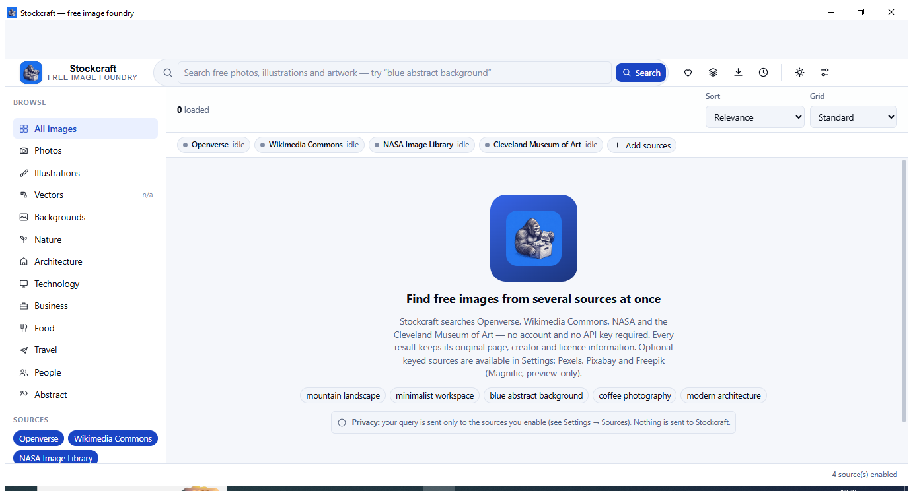
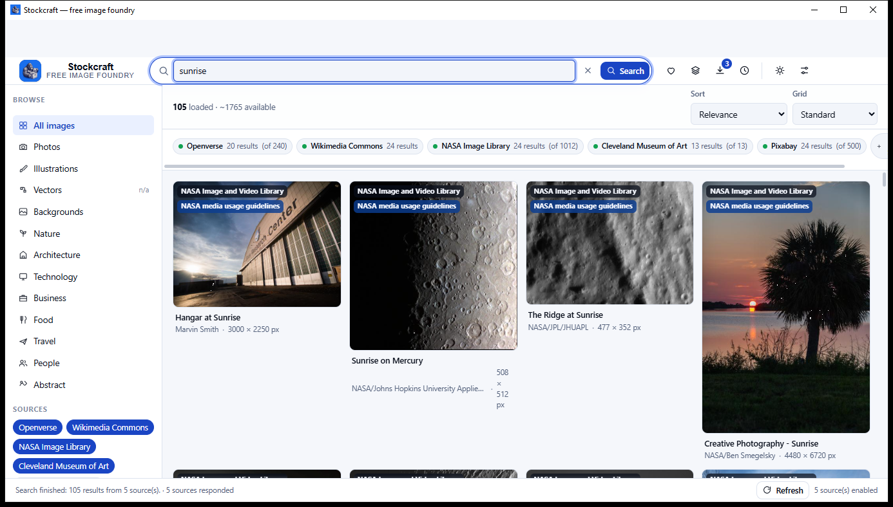
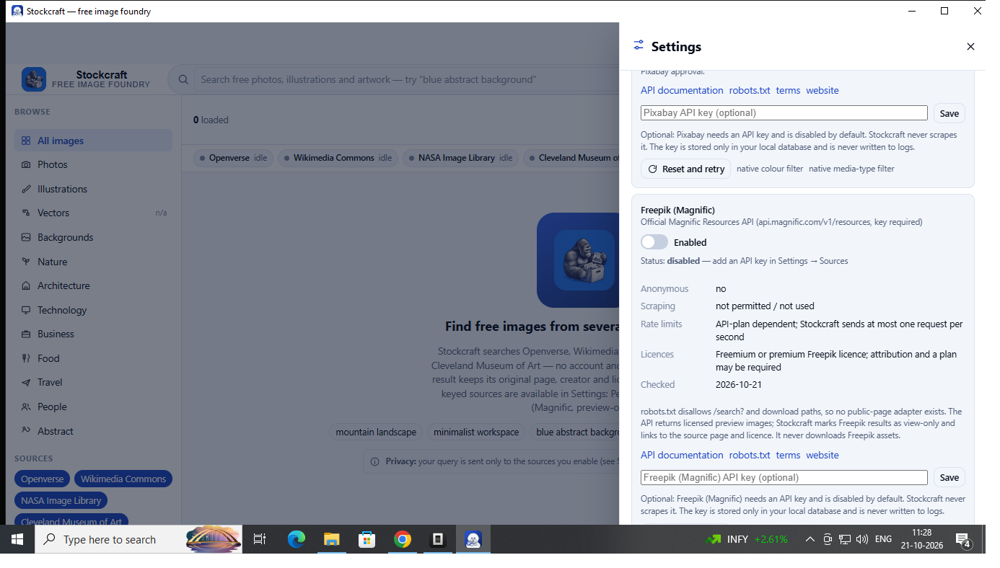
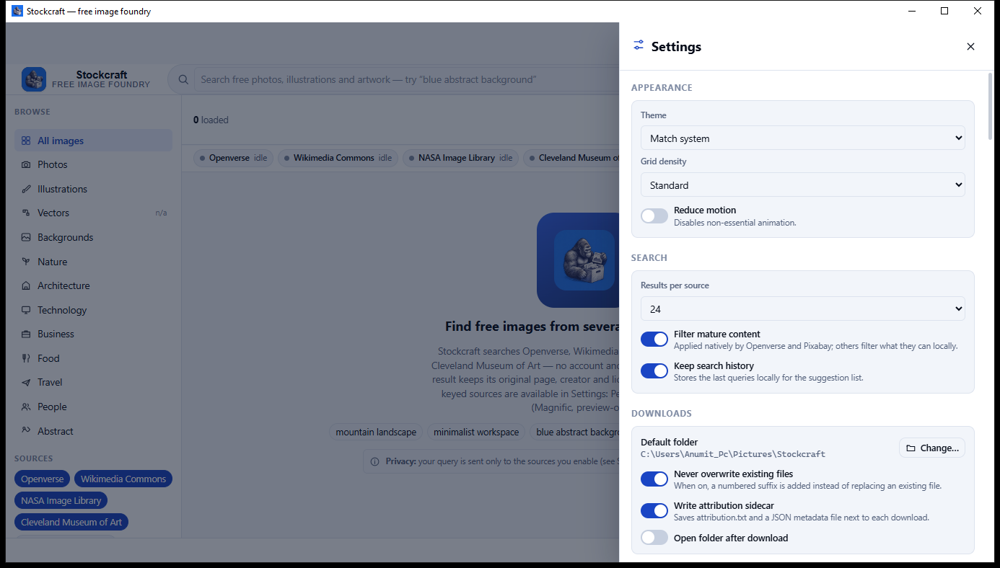

<div align="center">

# Stockcraft

**A free stock image discovery desktop app for Windows — built with Tauri 2, Rust and TypeScript.**

[](https://github.com/gggff123/Stockcraft/releases/latest)
[](LICENSE)
[](https://github.com/gggff123/Stockcraft/releases/latest)
[](https://tauri.app)

</div>

---

## What Stockcraft is

Stockcraft is a **local-first Windows desktop application** for discovering, previewing, organising and
downloading free images from several independent sources at the same time.

Instead of visiting one stock site at a time, you type one query and Stockcraft fans it out to every
source you have enabled, merges the results into a single grid, and keeps the **original source page,
creator and licence information attached to every result**.

It is built with [Tauri 2](https://tauri.app) (Rust backend), a TypeScript + Vite frontend with no UI
framework, and a bundled SQLite database. There is **no account, no telemetry, and no Stockcraft
server** — everything except the provider API calls happens on your machine.

**Who it is for**

- Designers and developers who need a licensed image *now* and do not want to sign up for four
  different stock accounts to find one.
- People who want to know exactly where an image came from and under what licence it was published
  **before** they use it.
- Anyone who prefers a desktop app that works on their own machine over a web app that profiles them.

**In one sentence:** one search box, four free image sources, full licence and attribution metadata,
and downloads that write a provenance record next to the file.

---

## Screenshots

| | |
|---|---|
|  <br> **Welcome screen** — nothing is fetched until you search. |  <br> **Search results** — results from four sources merged into one grid, with a live status chip per provider. |
|  <br> **Settings → Sources & policy** — every provider shows its access method, licence, rate limit and the date its policy was checked. |  <br> **The installed application** after running the NSIS installer. |

The two small images are the icon extracted from the current artefacts: the NSIS setup file
(`05-installer-icon.png`) and the installed executable (`06-installed-icon.png`).

Screenshots of earlier builds — captured before the Art Institute of Chicago source was removed — are
kept in [`docs/screenshots/legacy/`](docs/screenshots/legacy) for history. They are **not** the current
UI and are not shown above.

---

## Features

Everything listed below is implemented and exercised in the shipped build. Planned-but-unimplemented
items are listed explicitly under [Known limitations](#known-limitations) instead of being presented
as working.

### Search

- **Multi-source search** — one query is sent concurrently to every enabled provider (global cap of
  **4** in-flight provider calls).
- **Progressive results** — each provider streams its results in as they arrive, so the grid fills
  progressively instead of waiting for the slowest source.
- **Per-provider pagination** — "Load more" fetches the next page from each source independently.
- **Cancellation** — a running search can be cancelled; the UI recovers immediately and accepts the
  next query.
- **Search history** — the last queries are stored locally and offered as suggestions (`Ctrl+H`).
- **Safe search** — applied natively by Openverse (`mature=false`) and Pixabay (`safesearch=true`);
  assets flagged as mature are filtered out locally elsewhere.
- **Duplicate detection** — assets are deduplicated by provider id, canonical page URL and canonical
  image URL, with tracking parameters stripped before comparison.

### Filters, sorting and categories

- **Filters**: orientation, minimum width/height, media type, licence, colour and category.
- Filters are applied **natively where the provider supports it** and **locally otherwise** — the
  Sources panel shows which providers have native colour, media-type and licence filters, so the app
  never implies a filter was server-side when it was not.
- **Sorting**: relevance (provider order, untouched), newest, and largest — the latter two are
  applied locally.
- **13 category entries** in the sidebar. *Vectors* is deliberately disabled and marked `n/a`, because
  none of the four anonymous default providers offers vector search.

### Preview, licence and attribution

- **Detail modal** with a large preview, title, creator, source, dimensions, format, media type,
  licence name, licence URL, attribution text and the original source page.
- **Every result keeps its provenance** — creator, source page, licence name and licence URL are
  fetched from the provider and stored, not guessed.
- One-click **"Copy attribution text"** for the CC BY / CC BY-SA cases.
- All remote text is rendered as **text, never as HTML or script**.

### Downloads

- **Streaming downloads** with live progress, cancellation, a temporary file and an atomic rename, so a
  partial file never looks finished.
- **Safe filenames** — path separators, traversal sequences, Windows reserved names (`CON`, `PRN`, …),
  control characters, trailing dots/spaces and over-long names are all handled, and duplicate image
  extensions are not doubled (`.jpg.jpg`).
- **Overwrite protection** — with "Never overwrite existing files" on, a numbered suffix (` (1)`,
  ` (2)`, …) is added instead of replacing an existing file.
- **Attribution sidecars** — an optional `-attribution.txt` and a JSON metadata file are written next
  to each image, containing the source, the licence and a reminder to check the licence before reuse.
- **Limits enforced in code** — 200 MB per download, a 32 MB free-space reserve, and an `image/*`
  content-type requirement.
- A **downloads view** lists every transfer with its status, size, path and licence.

### Favourites and collections

- **Favourites** and **named collections** stored in the local SQLite library.
- Create, rename, delete (with confirmation), add, remove and browse collections in the main grid.
- The stable asset id and the canonical source page are stored — not just the thumbnail URL, which
  expires.

### Local storage, caching and settings

- **SQLite library** holding saved assets, favourites, collections, download records, search history,
  settings and the metadata cache. Image bytes are never stored in the database.
- **Thumbnail cache** on disk with LRU eviction and a configurable size cap (64 MB – 1 GB). Cached
  thumbnails are capped at 12 MB and must pass an image signature check — HTML disguised as an image
  is rejected.
- **Metadata cache** with a configurable TTL (default **30 minutes**, options 5–240 minutes, `0`
  disables it). *Pixabay is forced to a 24-hour TTL regardless of this setting, because its API terms
  require it.*
- **Scoped cache clearing** for thumbnails, metadata, or everything, with the freed byte count reported.
- **Settings** for theme (light / dark / match system), grid density, reduced motion, results per
  source, safe search, history, download folder, overwrite behaviour, sidecars, and optional API keys.
- **Diagnostics panel** — app version, OS, data paths, cache statistics and per-provider status, with
  a "Copy diagnostics" button. **API keys are never included** in the diagnostics output.

### Interface

- Light, dark and system themes; standard and dense grid layouts; reduced-motion support.
- Keyboard shortcuts: `/` focus search, `Ctrl+K` focus search, `Ctrl+H` history, `Ctrl+F` favourites,
  `Ctrl+Shift+C` collections, `Ctrl+D` downloads, `Ctrl+,` settings, `Ctrl+R` load more, `F` toggle
  sidebar, `Esc` dismiss.
- Responsive down to **900 × 600**; the settings drawer scrolls without horizontal overflow.

---

## Download and installation

> **Latest release:** <https://github.com/gggff123/Stockcraft/releases/latest>

### 1. Download the installer

From the [latest release page](https://github.com/gggff123/Stockcraft/releases/latest) download:

| Asset | What it is |
|---|---|
| `Stockcraft_0.1.0_x64-setup.exe` | The **NSIS installer**. This is the supported way to install Stockcraft. |
| `Stockcraft_0.1.0_x64-setup.exe.sha256` | SHA-256 checksum of the installer, for verifying the download. |

### 2. Verify the download (recommended)

```powershell
# PowerShell
Get-FileHash .\Stockcraft_0.1.0_x64-setup.exe -Algorithm SHA256
```

Compare the printed hash with the one in the `.sha256` file. They must match exactly. The same hash is
printed in the release notes.

### 3. Install

1. Double-click `Stockcraft_0.1.0_x64-setup.exe`.
2. If Windows shows a **"Windows protected your PC"** or **"Unknown publisher"** warning, click
   **More info** → **Run anyway**. See [Unsigned installers](#unsigned-installers-and-smart-screen)
   below for why this happens.
3. Follow the installer prompts. The default install mode is **per-user** (no administrator rights
   required) and installs to `%LOCALAPPDATA%\Stockcraft`.
4. Launch **Stockcraft** from the Start menu or the desktop shortcut.

### 4. Start searching

Type a query in the search box and press **Enter**. Nothing is requested from any provider until you
submit a search.

### Requirements

| | |
|---|---|
| **Operating system** | Windows 10 or Windows 11, **x64 (64-bit)** only. The installer and executable are x64; there is no 32-bit or ARM64 build. |
| **WebView2 Runtime** | Required. It ships preinstalled on current Windows 10 and Windows 11 systems; if it is missing, the installer downloads it automatically (the NSIS bundle is configured with Tauri's `downloadBootstrapper` mode, which needs an internet connection at install time). You can also install it manually from <https://developer.microsoft.com/microsoft-edge/webview2/>. |
| **Disk space** | ~10 MB for the application. The thumbnail cache is capped by you (64 MB – 1 GB, default 256 MB). |
| **Network** | Required for searching, thumbnails and downloads. Nothing else. |
| **Other runtimes** | None. The Rust backend is statically linked; no separate Rust or C runtime install is needed. |

### Unsigned installers and SmartScreen

**Stockcraft's release binaries are not code-signed.** The project has no paid code-signing certificate,
so Windows SmartScreen will show a **"Windows protected your PC"** warning for the first launch, and
some antivirus products may flag an unfamiliar unsigned installer.

This is a known, expected consequence of an unsigned release — not evidence of a problem with the file.
To verify the download independently, compare the SHA-256 hash against the published `.sha256` file as
described in step 2, and download only from the official
[GitHub release page](https://github.com/gggff123/Stockcraft/releases/latest).

### Troubleshooting

| Symptom | What to do |
|---|---|
| **"Windows protected your PC"** | Click **More info** → **Run anyway**, or verify the SHA-256 hash first. |
| **The app will not start / a blank window appears** | Confirm the WebView2 Runtime is installed (<https://developer.microsoft.com/microsoft-edge/webview2/>). A missing WebView2 runtime is the most common cause of a blank window. |
| **"This app can't run on your PC"** | You are on a 32-bit or ARM64 system. Stockcraft is x64 only. |
| **A search returns nothing** | Check the provider chips in the toolbar — they show `idle`, `no results`, `timed out`, `rate limited` or `unavailable` per source. Open **Settings → Sources & policy → Reset and retry** to clear a tripped circuit breaker. |
| **One source is missing results** | Openverse has a tight anonymous budget (20 requests/minute burst, 200/day). The app spaces requests, caches responses and opens a circuit on `429`. Wait, or add a key for one of the optional providers. |
| **Thumbnails do not appear** | Remote thumbnails are fetched through a local caching proxy. Check **Settings → Cache & storage** and try **Clear thumbnails**. A corporate proxy or firewall that blocks the provider domains will also block thumbnails. |
| **The installer cannot run** | Download the file again (a truncated download fails the hash check) and try **Run as administrator**. |
| **Downloads fail immediately** | Stockcraft only downloads over http(s) from URLs the provider publishes, and requires an `image/*` content type. Some providers publish previews only; those results are shown as view-only and cannot be downloaded. |

---

## Image providers and licensing

Stockcraft talks to **documented public APIs only**. It does **not** scrape any website's search pages,
and there is no proxying, identity rotation, CAPTCHA solving or `robots.txt` circumvention anywhere in
the codebase.

### Working out of the box (no account, no API key)

| Provider | Access method | Licence | Docs |
|---|---|---|---|
| **Openverse** | Official REST API (`api.openverse.org/v1`) | Per-item CC / public domain; attribution may be required | <https://api.openverse.org/v1/> · <https://openverse.org/terms/> |
| **Wikimedia Commons** | MediaWiki Action API (`commons.wikimedia.org/w/api.php`) | Per-file licence from each file's `extmetadata` | <https://www.mediawiki.org/wiki/API:Search> · <https://foundation.wikimedia.org/wiki/Policy:Terms_of_Use> |
| **NASA Image Library** | Public JSON API (`images-api.nasa.gov`) | NASA media usage guidelines — mostly public domain, **not all** | <https://images.nasa.gov/docs/images.nasa.gov_api_docs.pdf> · <https://www.nasa.gov/nasa-brand-center/images-and-media/> |
| **Cleveland Museum of Art** | Open Access API (`openaccess-api.clevelandart.org`) | CC0 for open-access works; otherwise copyrighted | <https://openaccess-api.clevelandart.org/> · <https://www.clevelandart.org/open-access> |

### Optional sources — require your own API key, disabled by default

| Provider | Access method | Licence | Docs |
|---|---|---|---|
| **Pexels** | Official API (`api.pexels.com/v1`) | Pexels licence | <https://www.pexels.com/api/documentation/> · <https://www.pexels.com/terms-of-service/> |
| **Pixabay** | Official API (`pixabay.com/api`) | Pixabay Content License (royalty-free; attribution not required) | <https://pixabay.com/api/docs/> · <https://pixabay.com/service/terms/> |
| **Freepik / Magnific** | Official Magnific Resources API (`api.magnific.com/v1/resources`) | Freemium or premium Freepik licence; attribution and a plan may be required | <https://docs.magnific.com/api-reference/resources/get-all-resources> · <https://www.freepik.com/terms-of-use> |

Add a key in **Settings → Sources & policy**. Keys are stored in your local database, are never
written to logs, and are never included in the diagnostics export. Freepik results are **preview-only**:
Stockcraft links to the source page and licence and never downloads Freepik assets, because reuse
requires a Freepik licence.

### Sources deliberately not supported

| Source | Why not |
|---|---|
| **Pexels public pages** | `pexels.com/robots.txt` disallows `*q=*`, the filter query strings, paging and `*/download/*` — exactly the URLs a page scraper needs. Stockcraft has no Pexels scraper; only the official keyed API. |
| **Freepik public pages** | `freepik.com/robots.txt` disallows `/search?`, `/*/search?`, `/download/`, `/download-file/` and `/trk-download/`. |
| **Google Images** | `google.com/robots.txt` disallows `/search` and `/imgres`; the Custom Search JSON API is closed to new customers and is scheduled to end on **2027-01-01**. Stockcraft contains no Google code at all. |
| **Art Institute of Chicago** | Removed after **12 of 12** IIIF preview requests returned HTTP 403 with `cf-mitigated: challenge` (Cloudflare), leaving a grid of broken thumbnails. |
| **Unsplash, Flickr, Smithsonian, Rijksmuseum, Europeana** | Require API keys and/or OAuth; not implemented. |

### Licensing — please read this

**Every image has its own licence, and "free" does not mean "free for anything".**

- A Creative Commons licence such as **CC BY** or **CC BY-SA** usually *requires attribution*, and
  **CC BY-SA** additionally requires that derivatives are shared under the same licence. **CC BY-NC**
  and **CC BY-ND** prohibit commercial use and/or derivatives.
- **Public domain / CC0** removes copyright restrictions, but some jurisdictions still recognise
  **moral rights**, and the depicted content may carry rights you cannot see (trademarks, likenesses,
  works of art in the background).
- **NASA media is not all public domain.** NASA content is generally not copyrighted, but it may
  contain identifiable people, insignia, logos or third-party material with separate restrictions.
  Stockcraft shows the NASA usage guidelines next to every NASA result and never claims a NASA image
  is free of third-party rights.
- **Stockcraft does not grant you any rights.** It surfaces the licence each provider publishes so you
  can check it. Always open the original source page and read the licence before you use an image.
- The optional attribution sidecar is a **convenience, not a substitute** for your own licence check.

### Provider failures and fallback

Providers are isolated from each other: **one source failing never stops the others.**

- Each provider call is wrapped; a failure becomes a status chip in the toolbar (`timed out`,
  `rate limited`, `unavailable`, `restricted`, `malformed`, `empty`) with a human-readable reason.
- Timeouts: 8 s connect, 15 s request (downloads: 10 s connect, 600 s total). Two retries with
  exponential backoff and jitter, for transient errors only.
- **Circuit breaker**: 3 consecutive transient failures open the circuit for 60 s, doubling to a
  15-minute maximum. A `429` or a policy response (`403`, `451`) opens it immediately. One half-open
  probe is allowed, and **Settings → Reset and retry** clears it manually.
- Malformed or empty payloads are reported as errors and are **never** converted into fake results.
- A cancelled search does not count as a provider failure.

---

## Privacy

Stockcraft is local-first. There is **no account, no analytics, no telemetry, and no Stockcraft server**.

**What leaves your machine**

- **Your search query** is sent to the providers you have enabled, and to nothing else. The
  **Settings → Privacy** panel lists exactly which enabled sources receive it.
- **Thumbnail and download requests** go directly to the provider domains that published the image.
- If you configure an optional API key, that key is sent to that provider's API as an authentication
  header — and to no one else.

**What never leaves your machine**

- Favourites, collections, download records, search history, settings and cached metadata — all in a
  local SQLite database.
- The optional API keys are stored in that local database. They are not written to the log file and
  are excluded from the diagnostics export.

**Where things are stored**

| What | Where |
|---|---|
| Database, thumbnails, logs | `%APPDATA%\app.stockcraft.desktop\` (the `stockcraft.db` file, a `thumbnails\` folder and a `logs\` folder with daily rotating `stockcraft.log` files) |
| Downloads | Your chosen folder, or `%USERPROFILE%\Pictures\Stockcraft` by default |

**Other network behaviour**

- The frontend performs **no unrestricted networking**. It calls Rust commands over the Tauri IPC and
  listens for Tauri events. All remote fetching happens in the Rust backend.
- Remote images are fetched by Rust through a **local caching proxy** (`http://thumb.localhost/…` on
  Windows), so provider requests are made from one place and cached on disk.
- External links are validated before being opened: http/https only, no embedded credentials, and no
  localhost or private-network addresses. `open_path` is restricted to your managed download folders
  and previously recorded download paths.
- A Content Security Policy is applied to the webview: no remote scripts, no remote fonts, `object-src
  'none'`.

**Deleting your data:** uninstalling the application does not remove `%APPDATA%\app.stockcraft.desktop`.
Delete that folder to remove the database, cached thumbnails and logs.

---

## Developer setup

### Prerequisites

| Requirement | Version | Notes |
|---|---|---|
| **Node.js** | 22 or newer (24.x verified) | Only the frontend build needs it. |
| **npm** | ships with Node | The project has a committed `package-lock.json`; use `npm ci` for reproducible installs. |
| **Rust** | 1.90 or newer (1.99.0 verified) | `rust-version = "1.90"` in `src-tauri/Cargo.toml`. |
| **Rust target** | `x86_64-pc-windows-gnu` | The project is developed and verified against the **MinGW/GNU** toolchain. See [Toolchain notes](#toolchain-notes). |
| **MinGW-w64** | any recent GCC | Must provide `gcc` and `ld` on `PATH` (this machine uses `C:\mingw64\bin`). |
| **WebView2 Runtime** | current | Required to *run* the app; already present on current Windows 10/11. |
| **Tauri CLI** | via npm | Provided by the `@tauri-apps/cli` dev dependency — no global install needed. |

### Install dependencies

```powershell
git clone https://github.com/gggff123/Stockcraft.git
cd Stockcraft
npm ci            # installs exactly what package-lock.json pins
```

### Run the development build

```powershell
npm run tauri:dev
```

This starts the Vite dev server on `http://127.0.0.1:1420` and opens the Tauri window pointed at it.
The port is fixed because `src-tauri/tauri.conf.json` refers to it in `devUrl`.

### Build the production application

```powershell
npm run tauri:build
```

This runs `tsc --noEmit && vite build` and then produces:

- `src-tauri/target/release/stockcraft.exe` — the release executable
- `src-tauri/target/release/bundle/nsis/Stockcraft_0.1.0_x64-setup.exe` — the NSIS installer

### Run the tests

```powershell
# Frontend: 19 Vitest + jsdom tests
npm test

# Frontend type check
npm run typecheck

# Rust: 65 unit tests + 1 integration test
cd src-tauri
cargo test
```

All provider tests use **static fixtures** — there is no live-provider test suite, so the test run
needs no network access.

### Formatting and linting

```powershell
cd src-tauri
cargo fmt --check
cargo clippy --all-targets -- -D warnings
```

`cargo fmt --check` and `cargo clippy --all-targets -- -D warnings` both pass on the current tree.
There is no ESLint or Prettier configuration in this project; the frontend is type-checked with
`tsc --noEmit` instead.

### Regenerate the app icons

```powershell
npm run icons
```

This regenerates the PNG/ICO/ICNS and mobile icon sets in `src-tauri/icons/` from
`assets/stockcraft-icon-source.png` and copies the 256 px icon to `public/icon.png`.

### Troubleshooting build errors

| Error | Cause and fix |
|---|---|
| **`link.exe not found`** or **`cc1: fatal error`** | MinGW is not on `PATH`. Add `C:\mingw64\bin` (or your MinGW directory) to `PATH` and open a new terminal. |
| **`error: export ordinal too large`** | You are building the `cdylib` target on the GNU toolchain. The project intentionally sets `crate-type = ["rlib"]` in `src-tauri/Cargo.toml` to avoid this — do not change it back to `cdylib`/`staticlib`. |
| **`.rsrc merge failure: multiple non-default manifests`** | A **cosmetic MinGW linker warning** caused by `src-tauri/build.rs` deliberately linking the Windows resource archive into every target (including test binaries, which need the Common-Controls v6 manifest to start at all). The build still succeeds and the executable contains one usable manifest. |
| **`STATUS_ENTRYPOINT_NOT_FOUND` when running `cargo test`** | The test binary is missing the Common-Controls v6 manifest. `src-tauri/build.rs` links it in; make sure you are not building with a different toolchain than the one that has the resource archive. |
| **The Tauri NSIS tool download times out** | The NSIS toolchain is downloaded on first use into `%LOCALAPPDATA%\tauri\NSIS`. It can be populated manually, or the build retried once the network is stable. |
| **PowerShell reports exit code 1 for a successful command** | `cargo` and `npm` write progress to stderr, which PowerShell surfaces as an error. **The final summary text is authoritative** — check that it says "Finished" / "passed" before treating it as a failure. |
| **`npm ci` fails with a lockfile mismatch** | `package-lock.json` and `package.json` are out of sync. Run `npm install` once locally and commit the updated lockfile. |

### Toolchain notes

The Rust default toolchain on the development machine is `stable-x86_64-pc-windows-gnu`, with
MinGW-w64 at `C:\mingw64\bin` on `PATH`. The build uses the GNU toolchain deliberately: `src-tauri/
Cargo.toml` sets `crate-type = ["rlib"]` because MinGW's linker overflows the export table when a
`cdylib` is produced on this target, and `src-tauri/build.rs` links the Windows resource archive
differently for MSVC (`resource.lib`) and GNU (`libresource.a`).

The GitHub Actions Windows runners provide MinGW-w64 at `C:\mingw64` and add it to the machine `PATH`,
so the same toolchain is available in CI.

---

## Project structure

```
Stockcraft/
├─ src/                                Frontend — Vite + TypeScript, no UI framework
│  ├─ main.ts                           Bootstrap, shell markup, global shortcuts, event wiring
│  ├─ components/
│  │  ├─ icons.ts                       Inline SVG icon set; raster brand mark
│  │  └─ ui.ts                          Modal, toast, skeleton, button and field primitives
│  ├─ features/
│  │  ├─ search/
│  │  │  ├─ chrome.ts                   Header, sidebar, categories, filters, provider rail, footer
│  │  │  ├─ controller.ts               Search submission, suggestions, pagination, view switching
│  │  │  ├─ options.ts                  Categories, sorts, filters, local matching, sorting
│  │  │  ├─ results.ts                  Results grid, empty/error states, welcome copy
│  │  │  └─ tile.ts                     Asset card, thumbnail proxy, favourite action
│  │  ├─ preview/preview.ts             Asset detail modal
│  │  ├─ collections/collections.ts     Favourites and named collections views
│  │  ├─ downloads/downloads.ts         Download list, progress, cancel, reveal
│  │  └─ settings/settings.ts           Settings, provider policy/health, cache, privacy, diagnostics
│  ├─ lib/
│  │  ├─ api.ts                         Typed Tauri IPC bridge (with a browser-only mock backend)
│  │  ├─ dom.ts                         Escaping `html`` template + render helpers
│  │  ├─ format.ts                      Byte/date/plural formatting, safe filename helpers
│  │  ├─ mock.ts                        Browser-only mock backend (never touches the network)
│  │  ├─ store.ts                       Tiny reactive store
│  │  └─ types.ts                       Shared wire types
│  └─ styles/
│     ├─ tokens.css                     Colour, spacing and typography tokens
│     └─ app.css                        Layout and component styles
│
├─ src-tauri/                           Rust backend — all networking, filesystem and SQLite work
│  ├─ src/
│  │  ├─ main.rs                        Windows entry point
│  │  ├─ lib.rs                         Tauri builder, app paths, rotating log, service wiring
│  │  ├─ commands.rs                    The single Tauri command surface (36 commands)
│  │  ├─ error.rs                       Typed AppError -> { code, message, detail }
│  │  ├─ models.rs                      Asset, SearchRequest, AppSettings, statuses, diagnostics
│  │  ├─ state.rs                       AppState, provider snapshots, thumbnail URI scheme
│  │  ├─ util.rs                        URL safety, safe filenames, HTML stripping, colour naming
│  │  ├─ providers/                     Provider adapters
│  │  │  ├─ mod.rs                      ImageProvider trait, registry, capabilities, policy records
│  │  │  ├─ http.rs                     Shared reqwest client, retries, policy/rate-limit classification
│  │  │  ├─ rate_limit.rs               Per-provider minimum interval limiter
│  │  │  ├─ health.rs                   Circuit breaker, cooldown, half-open probe, manual reset
│  │  │  ├─ openverse.rs                ├─ wikimedia.rs
│  │  │  ├─ nasa.rs                     ├─ cleveland.rs
│  │  │  └─ pexels.rs  pixabay.rs  freepik.rs   (optional, keyed)
│  │  ├─ search/
│  │  │  ├─ mod.rs                      Sessions, cancellation, cache, events, pagination, filtering
│  │  │  └─ dedup.rs                    Canonical id/page/image duplicate detection
│  │  ├─ downloads/mod.rs               Streaming, progress, cancel, atomic write, sidecars, limits
│  │  ├─ database/mod.rs                rusqlite schema, migrations and repositories
│  │  └─ cache/mod.rs                   Thumbnail proxy/cache, LRU eviction, metadata TTL helpers
│  ├─ build.rs                          Links the Windows Common-Controls v6 manifest into test binaries
│  ├─ tests/resource_manifest.rs        Integration test asserting the v6 manifest is embedded
│  ├─ capabilities/default.json         Tauri capability definitions
│  ├─ icons/                            Generated PNG / ICO / ICNS / mobile icon sets
│  ├─ Cargo.toml  Cargo.lock
│  └─ tauri.conf.json                   Product name, window, CSP and NSIS bundle configuration
│
├─ tests/frontend.test.ts               19 Vitest + jsdom tests
├─ assets/                              Source artwork (icon source PNG, mascot SVG)
├─ scripts/make-icons.mjs               Icon regeneration wrapper (`npm run icons`)
├─ public/                              Static files copied into the frontend build
├─ docs/screenshots/                    README screenshots (+ legacy/ for earlier builds)
├─ feat.md                              Feature inventory and verification record
├─ index.html  vite.config.ts  tsconfig.json  package.json  package-lock.json
└─ LICENSE                              MIT
```

---

## Contributing

Contributions are welcome.

1. **Open an issue first** for anything larger than a bug fix, so the approach can be agreed before
   the work is done. Describe the provider, the expected behaviour and the actual behaviour.
2. **Fork and branch** from `main`. Use a descriptive branch name (`fix/openverse-timeout`,
   `feat/collection-export`, …).
3. **Keep the invariants.** These are load-bearing and are checked by the test suite:
   - Only documented public APIs. **No scraping**, no `robots.txt` circumvention, no undocumented
     endpoints.
   - Every provider adapter carries a `ProviderPolicy` record stating its access method, docs URL,
     `robots.txt` URL, terms URL, whether scraping is permitted, whether anonymous access works, its
     rate limit, notes and the date it was checked.
   - Remote metadata is rendered as text, never as HTML.
   - Malformed provider responses become errors — never fabricated results.
   - Download URLs come only from the provider, over http(s), with an `image/*` content type.
4. **Add tests.** Provider parsers get fixture tests; anything touching URLs, filenames, filters,
   dedup or the database gets a unit test. The suite must stay offline-safe.
5. **Verify before opening a pull request:**

   ```powershell
   npm ci
   npm run typecheck
   npm test
   cd src-tauri
   cargo fmt --check
   cargo clippy --all-targets -- -D warnings
   cargo test
   ```

6. **Update `feat.md`.** It is the project's single source of truth for status. Update it in the same
   pull request, and only mark a feature `[x]` after it has actually been run — compiling is not
   verification.
7. **Open the pull request** against `main` and describe what you changed and how you verified it.

**Good first issues:** a Metropolitan Museum of Art adapter (the anonymous API works and the object
fetch is the only missing piece), a vector-only category view for keyed sources, per-collection export
to JSON/CSV, and a live-provider integration suite gated behind an environment variable.

---

## Security

**Do not report security issues in a public issue or a pull request.**

Please use GitHub's **private vulnerability reporting** for this repository
(**Security → Report a vulnerability** on the repository page, if enabled), or contact the maintainer
through their GitHub profile. Include the affected version, a description of the problem and, if
possible, steps to reproduce.

You should receive an acknowledgement within a few days. Please do not disclose the issue publicly
until it has been addressed.

---

## Known limitations

Honest list of what is **not** working or not finished:

- **Windows only.** No macOS or Linux build exists. The Tauri build emits a Linux warning that the
  binary may not start without a suitable WebKitGTK runtime.
- **The optional keyed providers have never been tested against a live API.** Pexels, Pixabay and
  Freepik/Magnific are implemented, policy-gated and fixture-tested, but no live key was ever
  supplied, so their real-world behaviour is unverified. An unauthenticated probe of the Pixabay
  endpoint returns HTTP 400 (missing key) and the Magnific endpoint returns HTTP 401 (missing key).
- **Freepik / Magnific's `filters[ids]` detail lookup** is untested live.
- **The metadata cache TTL is a single global value**, not per provider — with the documented
  exception that Pixabay is forced to 24 hours.
- **Colour filtering is exact provider-data matching**, not thumbnail analysis. Assets without
  published colour data are hidden while a colour filter is active.
- **The vector category is disabled** (`n/a`) because none of the four anonymous default providers
  offers vector search.
- **Cross-provider duplicate detection is fixture-tested only** — it has not been observed with a
  real duplicate image.
- **No live-provider test suite.** Provider outages and API schema changes are only detected by real
  searches.
- **The native folder picker** (`rfd::FileDialog`) is implemented but was not exercised interactively
  in the recorded verification pass.
- **No full accessibility audit** has been performed. Focus-visible styling exists, but there has been
  no screen-reader or contrast audit.
- **No code signing.** Release binaries are unsigned, so SmartScreen will warn on first launch.
- **No CI pipeline.** Builds are currently produced on a developer machine rather than by GitHub
  Actions. See [Releasing](#releasing) for the current process.
- **Perceptual-hash duplicate detection, collection export and Openverse OAuth** are not implemented.

---

## Releasing

The current release process is manual, and the artefacts published on the
[releases page](https://github.com/gggff123/Stockcraft/releases/latest) were built on a Windows
machine with the GNU/MinGW toolchain.

```powershell
# 1. Verify the tree
npm ci
npm run typecheck
npm test
cd src-tauri
cargo fmt --check
cargo clippy --all-targets -- -D warnings
cargo test
cd ..

# 2. Build the production bundle
npm run tauri:build

# 3. Locate and checksum the artefacts
$installer = "src-tauri\target\release\bundle\nsis\Stockcraft_0.1.0_x64-setup.exe"
Get-FileHash $installer -Algorithm SHA256

# 4. Create the tag and the release
git tag -a v0.1.0 -m "Stockcraft 0.1.0"
git push origin main --tags
gh release create v0.1.0 $installer "$installer.sha256" --title "Stockcraft 0.1.0" --notes-file notes.md
```

The version is kept in sync in four places: `package.json`, `src-tauri/Cargo.toml`,
`src-tauri/tauri.conf.json` and `feat.md`.

---

## License

Stockcraft is released under the **MIT License**. See [LICENSE](LICENSE) for the full text.

```
MIT License
Copyright (c) 2026 Stockcraft contributors
```

---

## Acknowledgements

Stockcraft is made possible by the providers whose public APIs it queries, and by the projects it is
built on:

- [Tauri](https://tauri.app) — the application framework
- [Rust](https://www.rust-lang.org) and [Tokio](https://tokio.rs) — the backend
- [TypeScript](https://www.typescriptlang.org), [Vite](https://vite.dev) and [Vitest](https://vitest.dev) — the frontend
- [rusqlite](https://github.com/rusqlite/rusqlite) — the embedded database
- [reqwest](https://github.com/seanmonstar/reqwest) — the HTTP client

Thank you to Openverse, the Wikimedia Foundation, NASA and the Cleveland Museum of Art for opening
their collections through documented APIs.
